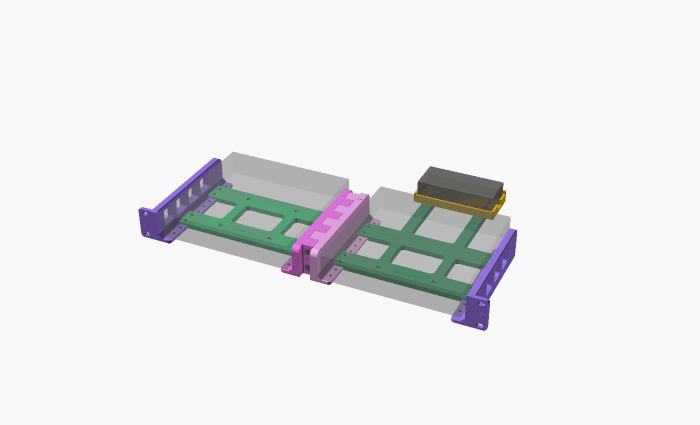
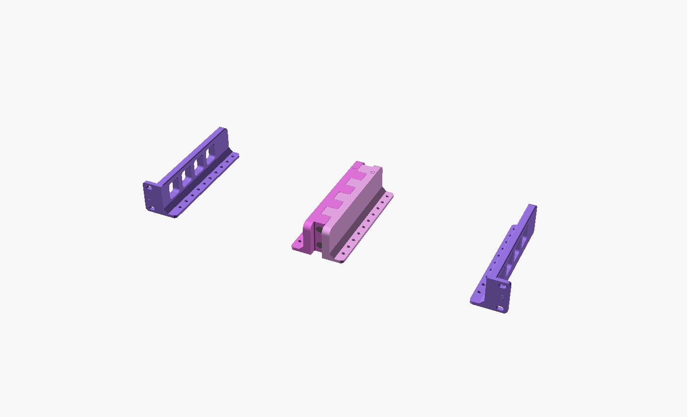
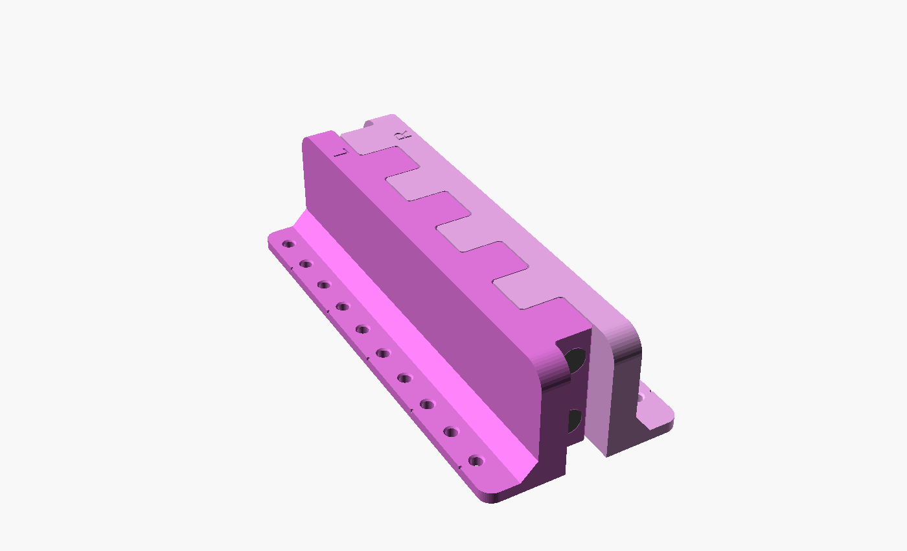
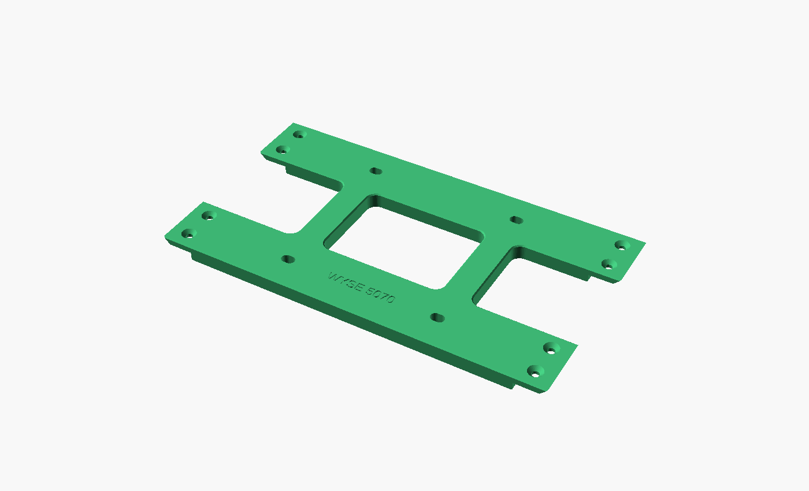
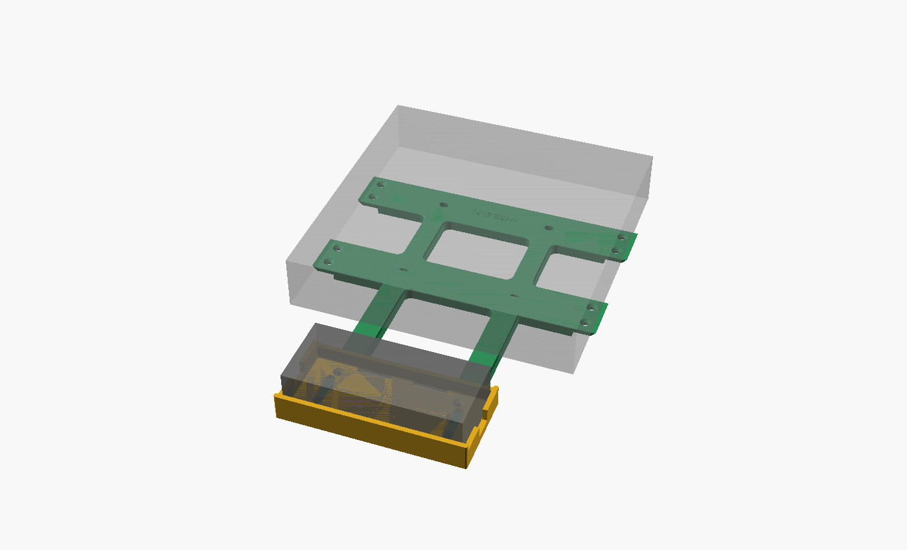

# Rackit

**3D-printed, half-width 1U mounts for small computers in a standard 19" rack.**

Rackit splits every 1U into two halves. Each half runs from a rack rail to the centre
line. The two halves join in the middle with a screw-pinned knuckle joint and act as one
beam from rail to rail. The frame is the same for every unit: two **ears**, two **spines**.
A new device only needs a small **harness**, printed once per device. It drops onto the
frame's ledges and holds the device.



| | |
|---|---|
|  |  |
| Standard frame: ears + spines | The centre joint: 4 knuckles per side, 4 deck screws |
|  |  |
| Wyse 5070 harness | Wyse harness + PSU caddy |

## How it works

- **Ears** screw to the rail with 2 screws each (top and bottom hole of the U). An L-shaped
  **ledge** runs along the inside of each ear, with a 45° chamfer and a row of M3 heat-set
  inserts every 15 mm.
- **Spines** meet at the rack's centre line. They have the same ledge on their outer face,
  and on their inner face 4 knuckles each that interlock with the other spine. Four
  #9 × 2½" deck screws, two from the front and two from the back, pin the knuckles together.
- **Harnesses** are device-specific bars or frames. They **rest on** the ledges, so the
  device's weight presses down into solid plastic, and M3 × 6 flat-head screws only hold
  them in place. Wherever possible the device's own case does the spanning: plastic grips,
  metal carries.
- Everything stays inside its U, so units stack directly with no gaps.

The full rules are in **[docs/STANDARD.md](docs/STANDARD.md)**.

## Devices

| Device | Status | Parts | Notes |
|---|---|---|---|
| Dell Wyse 5070 (slim) | ✅ printed | harness, harness + PSU, PSU caddy, hole template | 2 per 1U, lies on its mount face. [docs](docs/devices/wyse5070.md) |
| Beelink Mini S12 | planned | – | 115 × 102 × 39 mm, sits low between the ledges |
| Beelink SEi8 | planned | – | 124 × 113 × 41 mm, tight on height (feet pockets) |

Adding a device: **[docs/ADDING_A_DEVICE.md](docs/ADDING_A_DEVICE.md)**.
The reasons behind each design choice: **[docs/LESSONS.md](docs/LESSONS.md)**.

## Print it

Files in `stl/` are already oriented for printing. The number in front of each name is the print order.

| Order | File | Qty per 1U | Notes |
|---|---|---|---|
| 0 | `stl/tests/0_test_knuckle.stl` | 1 (once) | checks the centre joint and screw bite |
| 0 | `stl/tests/0_test_ledge_plate.stl` | 1 (once) | checks inserts, bar seat, M3 × 6 bite |
| 0 | `stl/devices/wyse5070/0_wyse_hole_template.stl` | 1 (once) | lay it on a Wyse to confirm the 75 mm pattern |
| 1 | `stl/standard/1_ear_left.stl`, `1_ear_right.stl` | 1 + 1 | ledge down, no supports |
| 2 | `stl/standard/2_spine_left.stl`, `2_spine_right.stl` | 1 + 1 | ledge down, no supports |
| 3 | `stl/devices/wyse5070/3_harness_wyse.stl` *or* `3_harness_wyse_psu.stl` | 1 per Wyse | already flipped: seat face down |
| 4 | `stl/devices/wyse5070/4_psu_caddy.stl` | 1 per PSU harness | flat |

**Settings (Bambu P1S):** PETG, 5 walls, 40 % gyroid for ears and spines, 30 % for harnesses.
Add a 100 % infill modifier around the insert holes. No supports.
**Don't use PLA.** It bent and broke in a warm attic (see LESSONS).

## Hardware per 1U unit (two Wyses)

| Item | Qty | Where |
|---|---|---|
| Rack screws (10-32, or M6 for an M6 rack) | 4 | ears to rails |
| #9 × 2½" exterior deck screws (Grip-Rite PTN212S5) | 4 | centre joint |
| M3 heat-set inserts, **short (3–4 mm)** | 16 (+4 per PSU harness) | ledges, PSU harness |
| M3 × 6 flat head (DIN 7991 / ISO 10642), **6 mm max** | 16 (+4 per caddy) | harness to ledges, caddy to harness |
| M4 × 10–12 flat head | 8 | Wyse to harness (check thread depth) |
| 20 mm velcro strap, ~25 cm | 2 per caddy | PSU |

## Build from source

```bash
tools/build.sh          # export every STL (tools/parts.txt) + render images/
python3 tools/check.py  # bed fit, 1U envelope, part-to-part interference
```

Needs OpenSCAD 2021.01+ and Python 3 with `trimesh`. CI runs both on every push.

## Layout

```
cad/lib/rackit.scad        the standard (constants + modules, renders nothing)
cad/rackit_standard.scad   ears, spines, test pieces
cad/devices/<device>.scad  one file per device: harnesses, accessories, templates
stl/                       print-ready STLs (generated)
images/                    renders (generated) - add photos of real prints here
tools/                     build.sh, render.py, check.py, parts.txt
docs/                      STANDARD, ADDING_A_DEVICE, LESSONS, devices/
```
