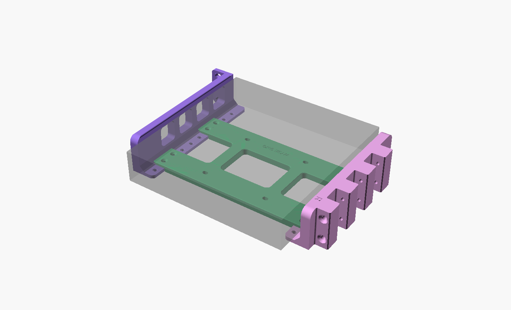

# Dell Wyse 5070 (slim chassis)

## Device

| | |
|---|---|
| Size | 184 × 184 × 35.6 mm lying flat (Dell: 184 H × 35.6 W × 184 D standing) |
| Weight | ~1.2 kg |
| Power | Dell 65 W 4.5 mm barrel adapter, ~108 × 47 × 28 mm (measure yours; a 90 W brick is bigger) |
| Power use | idle under 3 W; J4105/J5005 ~10 W TDP |
| Max ambient | 40 °C (104 °F) |
| Mounting | **4 screw holes in a square on the right side face** (used by Dell's VESA and monitor mounts; filler screws fitted). Keyholes in the bottom edge for the stand |
| Vents | top, left side, bottom. The right side (mount face) is not vented |

Dell officially supports the slim 5070 standing up only. Lying on its right side, the
vented left side faces up. Watch temperatures (see LESSONS).

## How it mounts

- Lies on its right side, **bolted with 4 × M4 flat heads from below** into the 75 × 75 mm pattern.
  The holes are slotted ±1 mm.
- The harness is a ladder frame: two 30 mm bars under the hole rows (y 52.5 and 127.5,
  matching grid pairs 45/60 and 120/135) and two ties under the hole columns.
- The Wyse's front is at y −2, about flush with the ear plates. Its top is at z 43.45.
- **Assumption to check:** the 75 mm pattern is centred on the face. Print the template first.

## Parts

| File | Qty | Notes |
|---|---|---|
| `0_wyse_hole_template.stl` | 1 | 1.5 mm. Lay it on the Wyse, raised text up, edges flush |
| `3_harness_wyse.stl` | 1 per Wyse | fits either half; prints seat face down |
| `3_harness_wyse_psu.stl` | 1 per Wyse with its PSU in the rack | adds 2 low extensions + 4 insert holes behind the Wyse |
| `4_psu_caddy.stl` | 1 per PSU harness | fits either half; 2 × 20 mm velcro straps |

The caddy starts 40 mm behind the Wyse so the plugs have room, and **reaches y = 274 mm**.
Check your rack has that depth.

## Assembly

Everything goes together on the bench; the finished unit goes into the rack last.

1. Fit the inserts: ledge positions 45, 60, 120, 135 on the ear **and** the spine. For the PSU harness, add 4 in its extensions.
2. Join the two spines with 4 deck screws.
3. Lay each harness across its ear ledge and spine ledge: 8 × M3 × 6 flat head per harness.
4. Wyse onto its harness: 4 × M4 from below. The Wyse covers the M3 screws, so this order matters.
5. PSU caddy onto the extensions (4 × M3 × 6), strap in the PSU.
6. Lift the unit into the rack and fix 4 rail screws.

Swapping a Wyse: take the unit out (4 rail screws), flip it, remove 4 × M4.

## Status

- ✅ Ledge test, knuckle test, ears and harness printed (PETG, P1S) and fit.
- ⏳ PSU harness and caddy designed and checked in CAD, not yet confirmed in print.
